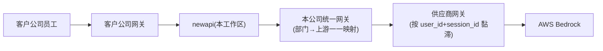
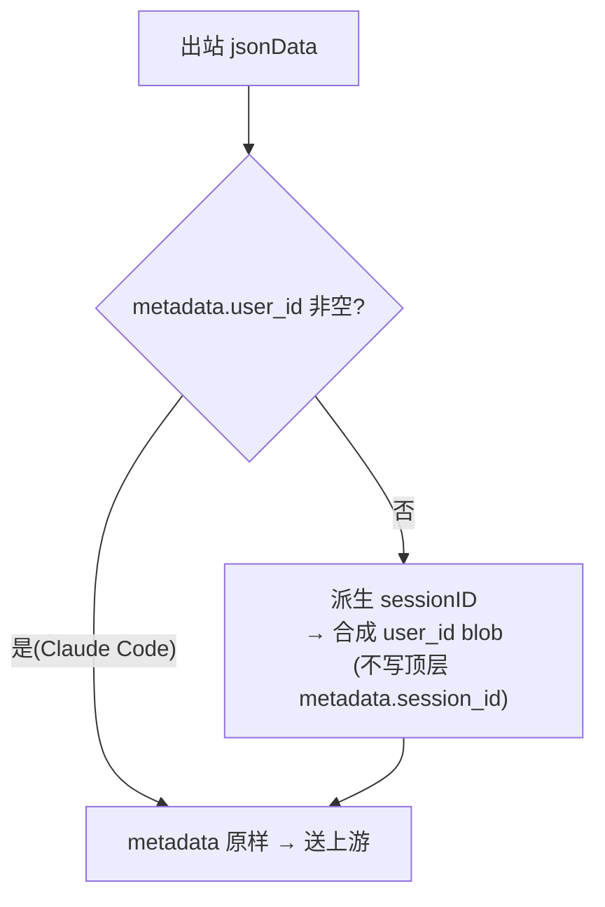

# Claude 缓存命中率调优:分析与方案

> 实现参考见 `docs/claude-metadata-session-injection.md`;本文侧重问题分析、关键决策与依据、验证与风险,便于对内/对供应商沟通。

## 结论先行

- 缓存命中率低的核心是**会话黏滞信息在转发链路里缺失**,供应商网关无法把同一会话稳定路由到同一后端节点,导致节点本地缓存难命中。
- newapi 在出站 Claude `/v1/messages` 请求上,为**缺 `metadata.user_id` 的请求**合成一个仿 Claude Code 的 `user_id` blob,内嵌 `device_id`(API key 末 6 位)与派生的 `session_id`。
- **不写顶层 `metadata.session_id`**(实测被上游拒绝);session 一律内嵌在 `user_id` blob 内,与真实 Claude Code 同形。

## 问题与调用链路



- 客户主要是 Claude Code,也有 pi / copilot / python 等,大多走 `/v1/messages`。
- 供应商反馈:部分请求缺少标准会话信息,无法做会话黏滞 → 命中率低。

<!-- APPEND-ANCHOR -->

## 缓存与黏滞机制(关键事实)

- **prompt 缓存是"内容寻址"**:缓存键 = 渲染后 prompt 的精确字节前缀(顺序 `tools → system → messages`)+ `cache_control` 断点。`user_id` / `session_id` **不参与官方缓存键**。
- **按模型隔离**:换模型(甚至同模型的新版本)会使缓存失效,新模型需重新建缓存。
- **作用域**:直连 Claude API / AWS / Foundry 按 workspace 隔离;Bedrock / GCP 按 organization 隔离(2026-02 起)。
- **user_id / session_id 的真正用途**:供应商网关据此做**节点黏滞**——把同一会话路由到持有热缓存的同一节点。两者是"两级键":`user_id` 粗粒度(用户/租户,也用于 Anthropic 滥用检测),`session_id` 细粒度(每会话)。缺任一都会让黏滞退化为随机路由(**静默降级**,不报错,只是命中率变差)。

## 客户端现状

- **Claude Code**:发送 `metadata.user_id`,其值是一个 JSON 字符串 `{"device_id":"<64hex>","account_uuid":"","session_id":"<uuid>"}`;`device_id` 每安装持久、`session_id` 每会话变。顶层**不带** `metadata.session_id`。另有请求头 `x-claude-code-session-id` 与之一致。
- **pi / copilot / python 等**:多数不带 `user_id`,更不带 `session_id`——这正是"部分请求缺会话信息"的来源。

## 关键决策与依据

- **user_id 来源 = API key 末 6 位**(部门级):每部门一个 key,稳定、可控;低熵/撞号可后续换 `token_id` 或 key 的 hash 前缀。
- **session_id 派生优先级**:`x-claude-code-session-id` 头 › ephemeral `cache_control` 内容 › `clientIP+UA+apiKey` 兜底(兜底**不含提示词文本**,保证多轮稳定)。
- **纳入 model**:换模型必丢缓存,故 model 进种子,换模型即换 session,路由与缓存边界对齐。
- **system 取"稳定前缀"(方案 A)**:只取到第一个 `cache_control:ephemeral` 断点为止(含该块),排除动态尾部,避免尾部变动翻转 session。
- **顶层 `metadata.session_id` 不可加**(实测被拒,Anthropic metadata 只允许 `user_id`)→ session 内嵌到 `user_id` blob,保持与真实 CC 同形。
- **闸门 = 是否已有 `metadata.user_id`**:有则完全不动(CC 自带会话);无则合成。

<!-- APPEND-ANCHOR-2 -->

## 最终方案

缺 `metadata.user_id` 时合成:

```json
{"device_id":"<key末6位>","account_uuid":"","session_id":"<16位 xxhash64>"}
```

其中 `session_id = xxhash64(model ␟ 稳定system前缀 ␟ 会话标识)`(`␟` = `\x1f`),取 16 位十六进制。



## 验证方法

- 开 debug(见 `docs/debug-mode-runtime-toggle.md`),抓出站 `requestBody:` 日志。
- 用 jq 核对注入结果:

  ```bash
  grep -F 'requestBody: ' $LOG_DIR/oneapi-*.log | sed 's/.*requestBody: //' \
    | jq -rc '{user_id: .metadata.user_id, has_top_session: (.metadata.session_id!=null)}'
  ```

- 期望:合成请求的 `metadata.user_id` 是含 `session_id` 的 blob,且 `has_top_session=false`(不写顶层)。

## 按分组+模型强制 1 小时缓存 TTL

针对"长会话有自然停顿、5m 缓存频繁过期"的场景,可对**指定 (分组, 模型)** 强制把 prompt 缓存 TTL 从默认 5m 提升到 1h。按模型收敛是必须的:**对只支持 5m 的模型发送 `ttl` 字段会被 Bedrock 直接 `ValidationException`**。

生效条件(全部满足):

- 请求的 **using group**(auto 跨组重试时解析为实际命中的 group)+ **出站 model** 命中某条规则;
- 走 Claude `/v1/messages` 的**非透传**路径;
- 请求体里**已存在** `cache_control` 断点(不新建断点)。

命中后做两件事:

1. **Body**:把 `system` / `tools` / 各 `messages[].content` 中已有的 `cache_control` 全部改为 `{"type":"ephemeral","ttl":"1h"}`(保留 type,覆盖原 5m);无断点的块、string 型 system/content 不动。
2. **Header**:向出站 `anthropic-beta` 追加 `extended-cache-ttl-2025-04-11`(保留客户端已有 beta、去重)。

配置(option key `extended_cache_ttl_setting`,按 `(group, models)` 规则):

```json
{
  "rules": [
    { "group": "groupA", "models": ["claude-opus-5-5", "claude-sonnet-5-5"] },
    { "group": "groupB", "models": ["claude-*"] }
  ]
}
```

- `rules` 为空 = 关闭。model 匹配:精确名、以 `*` 结尾的前缀、或单独 `*`(该组所有模型)。
- 判定:`operation_setting.ShouldForceExtendedCacheTTL(group, model)`,`model` 取出站 body 的 `model` 字段。

设置示例(root access token;option 接口同 Debug 开关,见 `docs/debug-mode-runtime-toggle.md`):

```bash
curl -X PUT 'https://<your-host>/api/option/' \
  -H 'Authorization: <root-access-token>' \
  -H 'Content-Type: application/json' \
  -d '{
    "key": "extended_cache_ttl_setting",
    "value": "{\"rules\":[{\"group\":\"groupA\",\"models\":[\"claude-opus-5-5\"]},{\"group\":\"groupB\",\"models\":[\"claude-*\"]}]}"
  }'
```

> `value` 需为该配置对象的 **JSON 字符串**(整段转义)。确认当前值:`curl 'https://<your-host>/api/option/' -H 'Authorization: <root-access-token>'`,在列表里找 `extended_cache_ttl_setting`。

<!-- TTL-MATRIX -->

### Bedrock 支持矩阵(AWS 官方 Prompt caching 文档)

- **模型**:5.5 系(`claude-opus-5-5` / `sonnet-5-5` / `haiku-5-5` / `fable-5-1`)GA 支持 `5m, 1h`,断点字段 `system`/`messages`/`tools`,min 512 token/断点、最多 4 断点。旧模型仅 5m,带 `ttl` 会 `ValidationException`(无优雅降级)。
- **推理类型**:**仅 on-demand 支持 prompt caching**(含 cross-region inference profile,高峰期可能增加 cache write);**批处理 batch 不支持**;**Provisioned Throughput 不支持**(非 on-demand)。
- **"订阅"类资源**:能否命中取决于其底层推理类型——on-demand 可以,预置吞吐/批处理不行。需向供应商确认该资源在 Bedrock 侧的推理类型。
- 混用约束:同请求里 1h 断点必须排在 5m 之前(我们全部统一 1h,无此问题)。

### 后端是否参考 agent 等标识?不参考

Anthropic/Bedrock 的缓存是**内容寻址**:键 = `tools → system → messages` 前缀字节 + `cache_control` 断点 + model。`metadata.user_id` / `session_id` / agent / request-id 等标识**都不进缓存键**,而且把它们塞进被缓存的 prefix 反而会**破坏**缓存。这些标识只在**供应商网关的黏滞路由层**被使用;Bedrock 缓存既不读它们、也不用它们做路由。

### 前提与成本

- `cache_control` 与 `anthropic-beta` 需能穿过沿路网关到达 Bedrock(与"转发层丢失"同理,逐跳确认)。
- **1h 写入成本约为 5m 的 ~2x**(读取不变),按 (组, 模型) 灰度、观察 `cache_creation`/`cache_read` 与成本再放量。

## 风险与待确认

- **供应商需从 `user_id` blob 解析 `session_id`**(与真实 CC 一致)——请与供应商确认。
- `device_id` 为部门级、粒度粗;兜底按 `clientIP+UA+apiKey` 会把多个真实会话合并。
- 仅**非透传**分支生效;若开启透传(全局 `PassThroughRequestEnabled` 或渠道 `PassThroughBodyEnabled`),不注入。
- **换模型必丢官方缓存**;不带 `cache_control` 的客户端无论黏滞与否都不命中,属另一独立因素。

## 相关文件

- 实现与测试:`relay/claude_handler.go`、`relay/claude_handler_metadata_test.go`、`relay/claude_handler_cache_ttl_test.go`
- 1h TTL 分组+模型设置:`setting/operation_setting/group_model_rule.go`(`GroupModelRuleSetting` + `ShouldForceExtendedCacheTTL`,测试 `group_model_rule_test.go`)
- 实现参考文档:`docs/claude-metadata-session-injection.md`
- Debug 运行时开关:`docs/debug-mode-runtime-toggle.md`

## 附录:各编程客户端的会话标识方式

> 来源:部分来自本仓库 `setting/operation_setting/channel_affinity_setting.go` 的透传头清单,部分来自各项目 2026 年的 issue/文档实测。

- **Claude Code**
  - Body:`metadata.user_id` = JSON 字符串 `{"device_id","account_uuid","session_id"}`,**session 内嵌其中**;顶层不带 `metadata.session_id`。
  - Header:`x-claude-code-session-id`(与 blob 内 session_id 一致)。UA:`claude-cli/<ver>`。per-conversation 稳定。
- **OpenAI Codex CLI**
  - Body:`prompt_cache_key` = 会话级稳定值(= conversation_id,跨轮不变)。
  - Header:`session_id` / `thread_id`(含 `Session_id`/`Thread_id`)、`Originator`、`X-Client-Request-Id`、`X-Codex-Turn-State` 等;环境变量 `CODEX_THREAD_ID`。注意 session-id 头对缓存复用的影响独立于 `prompt_cache_key`。
- **OpenCode(客户端 + 网关约定,被多数 agent 复用)**
  - Header:`x-opencode-session`(稳定 per-conversation UUID),可选 `x-opencode-client`。OpenCode Go 网关自 2026-09-05 起强制该头,缺失返回 400 `MissingSessionID`。
- **pi(earendil-works/pi)**
  - 对 `opencode`/`opencode-go`/`zen`:新版发 `x-opencode-session`(来自 `options.sessionId`),可选 `x-opencode-client: pi`;旧版不发。
  - 对其它 provider:无统一会话头,需在 `models.json` 的 `providers.<name>.headers` 手配。旧版 UA 暴露为 "JavaScript OpenAI client"。
- **GitHub Copilot(Chat / CLI)**
  - **原生不发稳定的 per-conversation 会话 ID**;只发 per-request 的 `X-Request-Id`/client request id,以及 `X-GitHub-Api-Version`、`Editor-Version`、`Editor-Plugin-Version`。UA:`GitHubCopilotChat/<ver>`。属最难做会话黏滞的一类。
- **Grok / xAI**:Header `x-grok-conv-id`(会话 id)。
- **通用 OpenAI 兼容**:常见 `session_id` / `conversation_id` 头、`x-session-id` / `x-session-affinity`,Body `prompt_cache_key`。

稳定可用:Claude Code、Codex、OpenCode/新版 pi、Grok。缺失/不稳定:GitHub Copilot、旧版 pi(非 opencode provider)、裸 OpenAI SDK 客户端。

### 对本实现的映射

- 走 Claude 格式 `/v1/messages` 的请求里,只有 `x-claude-code-session-id` 原生对口 → 已作为派生 `session_id` 的**第一优先级**。
- Codex 的 `prompt_cache_key`、OpenCode 的 `x-opencode-session`、Grok 的 `x-grok-conv-id` 是其它格式上的会话标志;这些客户端若以 Claude 格式打进来通常不带 claude 专用头 → 落到兜底链(ephemeral `cache_control` 内容 › `clientIP+UA+apiKey`)。
- Copilot 基本给不出稳定会话信号 → 必然走兜底(粗粒度但稳定)。
- 如需让派生链也认 Codex/OpenCode/Grok 这些头,可在 `deriveClaudeSessionSeed` 的头读取中追加对应头名(当前仅读 `x-claude-code-session-id`)。

