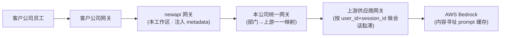
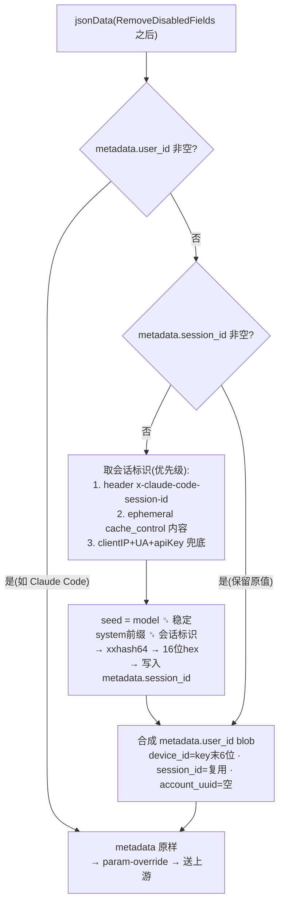

# Claude metadata 会话信息注入(user_id / session_id)

## 背景

调用链路:客户公司员工 → 客户网关 → 本 newapi 网关 → 本公司统一网关 → 上游供应商网关 → AWS Bedrock。

客户反馈缓存命中率低。上游供应商按 `metadata.user_id` + `metadata.session_id` 做**会话黏滞路由**(把同一会话的请求打到同一后端节点,以复用该节点的本地 prompt 缓存)。问题在于:

- 大量客户端(pi、copilot、python 等)根本不发送这些字段;
- Claude Code 虽然发送 `metadata.user_id`,但它把 `device_id` / `account_uuid` / `session_id` 包成一个 **JSON 字符串**塞在 `user_id` 里,顶层并没有 `metadata.session_id`。

> 说明:Anthropic/Bedrock 的 prompt 缓存是"内容寻址"的(前缀内容 + `cache_control` 断点 + model),`user_id` / `session_id` **不参与官方缓存键**。它们只服务于供应商网关的**节点黏滞**;黏滞做对 → 节点本地缓存更容易命中。

本功能在 newapi 这一层,为**缺字段的请求**补齐 `metadata.user_id` 与 `metadata.session_id`。

## 调用链路

- newapi 负责在出站 body 上补齐 `metadata`;统一网关只做部门→上游的一一映射,不参与黏滞。
- 供应商网关用 `user_id`+`session_id` 把同一会话路由到同一节点;Bedrock 的 prompt 缓存按内容前缀命中。

## 适用范围

- 仅作用于 Claude 原生 `/v1/messages` 路径(`relay.ClaudeHelper`,`relay/claude_handler.go`)。
- 仅在**非透传**分支生效:若开启全局 `PassThroughRequestEnabled` 或渠道 `PassThroughBodyEnabled`,走原始 body 透传,不注入。
- 注入发生在 `RemoveDisabledFields` 之后、param-override 之前。

## 行为

闸门统一以**客户端是否已带 `metadata.user_id`** 为准:

- **已带 `user_id`(典型:Claude Code)→ 完全不动 metadata**:既不改 user_id,也不注入 session_id,交由供应商自行从 user_id blob 解析会话。
- **未带 `user_id` → 同时补齐**:
  1. `metadata.session_id` = 派生的会话 hash(若客户端已自带非空 session_id,则保留不覆盖);
  2. `metadata.user_id` = 仿 Claude Code 的 JSON 字符串 blob —— `device_id` 取 API key 末 6 位,`session_id` 复用上一步写入的值(两处一致),`account_uuid` 为空。

执行顺序:先 `fillClaudeMetadataSessionID`,后 `fillClaudeMetadataUserID`(便于 blob 复用已写入的 session_id)。

<!-- APPEND-ANCHOR -->

## 注入流程图

对应 `ClaudeHelper` 非透传分支里先后调用 `fillClaudeMetadataSessionID` 与 `fillClaudeMetadataUserID`;两者都以 `metadata.user_id` 是否存在为闸门。

## session_id 派生

种子 = `model` ␟ `稳定 system 前缀` ␟ `会话标识`(`␟` 为 `\x1f` 分隔符),再 `xxhash64` → 16 位十六进制(`fmt.Sprintf("%016x", xxhash.Sum64String(seed))`)。三段皆空时返回空、跳过写入。

- **model**:取请求体 `model`。换模型 → 种子变 → session_id 变,与"换模型必丢缓存"对齐。
- **稳定 system 前缀(`claudeStableSystemPrefix`)**:取 system 数组中到**第一个带 `cache_control:{type:"ephemeral"}` 断点为止(含该块)** 的文本;无断点时回退首个 block;string 型 system 用全文。断点之后的**动态尾部被排除**,避免尾部变动翻转 session。
- **会话标识(`claudeConversationSeed`,优先级从高到低)**:
  1. 请求头 `x-claude-code-session-id`;
  2. 带 ephemeral `cache_control` 的 system/消息块文本拼接(`claudeCacheControlSeed`);
  3. 兜底 `clientIP + User-Agent + apiKey`(`claudeFallbackSessionSeed`,**不含任何提示词文本**,保证多轮稳定)。

## 关键实现位置

- `relay/claude_handler.go`
  - `fillClaudeMetadataSessionID` / `fillClaudeMetadataUserID`
  - `deriveClaudeSessionSeed` / `claudeConversationSeed` / `claudeStableSystemPrefix` / `claudeCacheControlSeed` / `claudeFallbackSessionSeed` / `claudeSessionHash`
  - `claudeMetadataUserID` 结构体(`device_id` / `account_uuid` / `session_id`)、`claudeDerivedDeviceIDLen = 6`
  - 调用点在 `ClaudeHelper` 的非透传分支
- API key 来源:上下文 `constant.ContextKeyTokenKey`(= `token.Key`,已去除 `sk-` 前缀)
- 依赖:`github.com/cespare/xxhash/v2`(go.sum 已存在;如需把 go.mod 的 `// indirect` 清理掉可执行 `go mod tidy`)

## 边界与注意事项

- **真实 Claude Code 不会被注入顶层 `metadata.session_id`**(因其已带 user_id)。若供应商必须在顶层看到 session_id、不愿解析 user_id blob,需要改为"即使有 user_id 也从 blob 提升 session_id"——与当前闸门相反,目前未实现。
- **`device_id = key 末 6 位是部门级**、低熵:两个 key 末 6 位相同会跨部门撞号。如介意可改用 `token_id` 或 key 的 hash 前缀(仅换派生来源,闸门不变)。
- **兜底粒度较粗**:同一 `clientIP + UA + apiKey` 会被归为一个 session(多个真实会话合并);但保证稳定、不逐轮漂移。
- 只补齐、不覆盖:客户端已有的 user_id 原样保留;session_id 仅在客户端未自带时写入。

## 测试

`relay/claude_handler_metadata_test.go`(表驱动,`testify`):

- **user_id**:无 metadata 合成 blob、复用已有 session_id、客户端 user_id 原样保留、空 user_id 视为缺失、key 过短/为空不改。
- **session_id**:header 优先且与 model + 稳定前缀组合、cache_control 回退、兜底跨轮稳定、换模型改变、system 尾部变化不改变、**有 user_id 则不注入**、已有 session_id 保留。

运行:`go test ./relay/ -run TestFillClaudeMetadata`。

